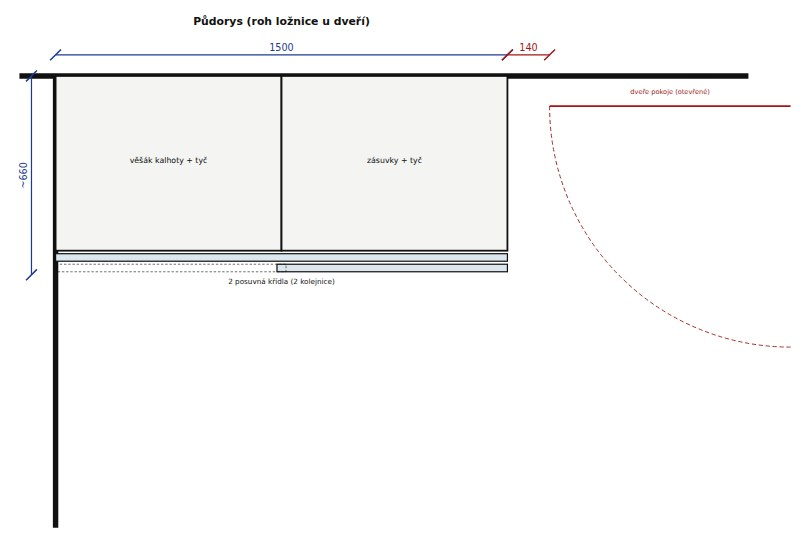
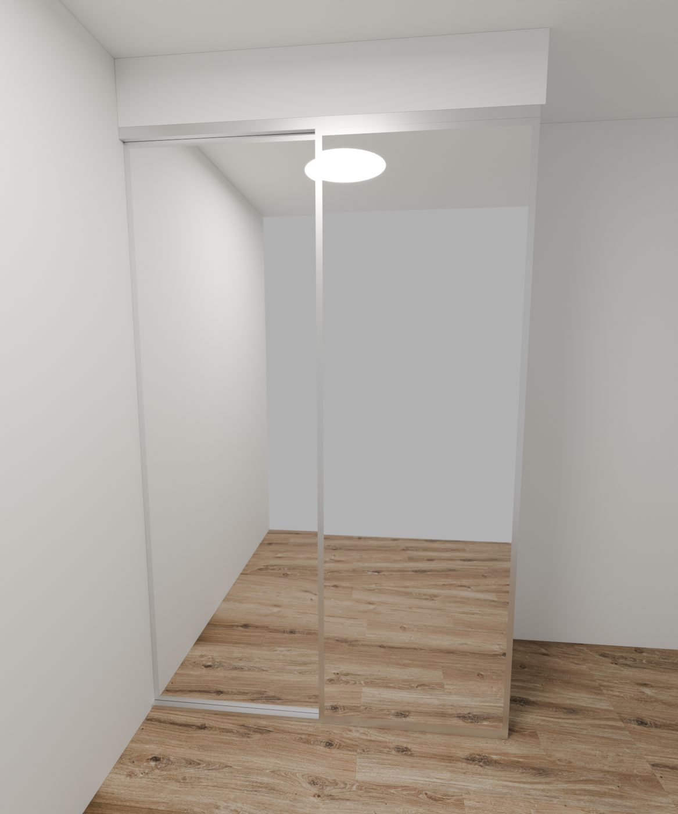
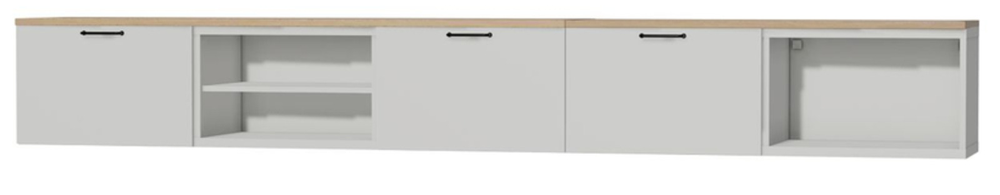
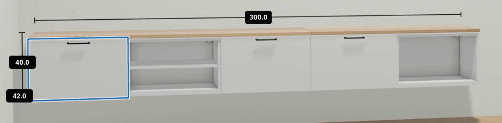
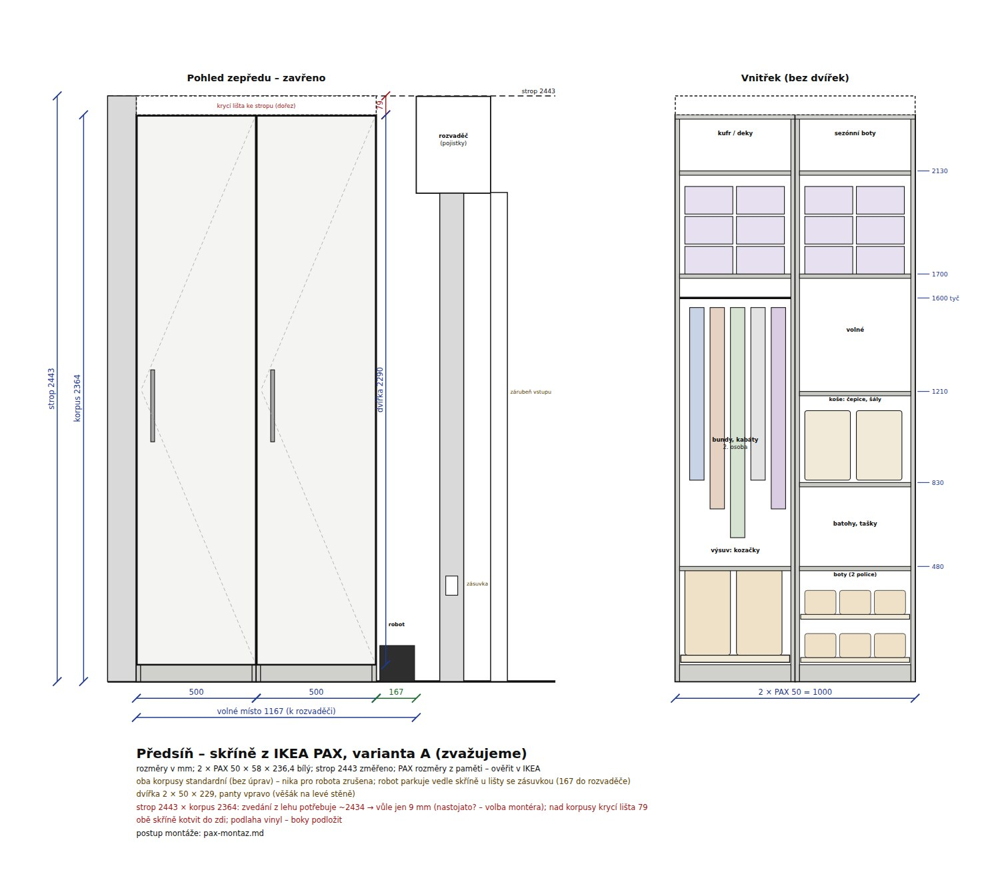
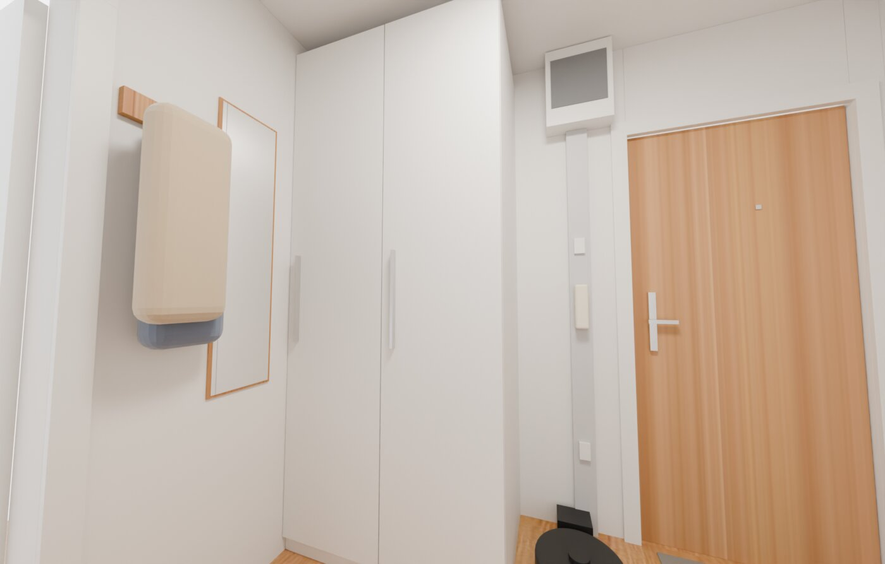
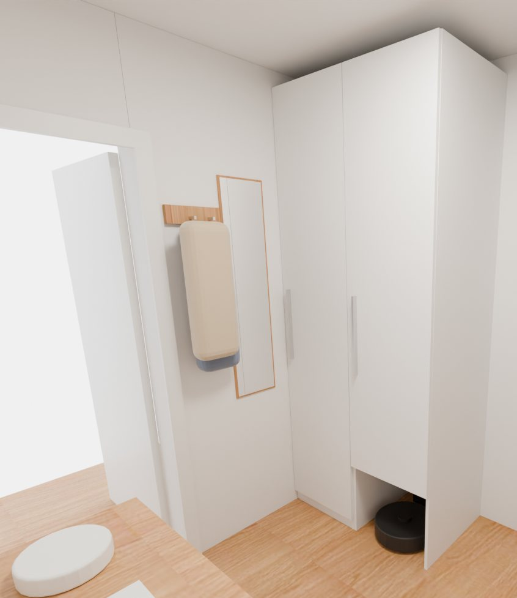

# Podklad pro montáž z IKEA – byt 2+kk (listopad 2026)

Dobrý den, posíláme seznam věcí, které bychom rádi pořídili **z IKEA** a nechali složit.
U každé věci je **náš rozměr** (z měření v bytě), **náš tip na IKEA řadu** a obrázek, jak si to představujeme.

**Prosíme o:** ověření, jestli to z IKEA jde (rozměry, dostupnost, plánovač PAX/BESTÅ), případně
lepší návrh, a orientační cenu (díly + montáž). Tipy na konkrétní řady jsou naše odhady – rádi se necháme poradit.

Všechny rozměry jsou v **mm**, světlé rozměry mezi stěnami. Rendery jsou orientační (barvy, proporce).

| # | Věc | Místnost | Náš tip IKEA | Priorita |
|---|---|---|---|---|
| 1 | Šatní skříň 1500 × 600 se zrcadlovými posuvnými dveřmi | ložnice | PAX 2 × 75 + posuvné dveře 150 + KOMPLEMENT | vysoká |
| 2 | Plovoucí TV skříňky 3000 × 420 × 400 | obývák | **BESTÅ – hotový návrh z plánovače, kód 34HSQ9C** | vysoká |
| 3 | 2 vysoké skříně v předsíni | předsíň | PAX 2 × 50 (standardní, bez úprav) | zvažujeme |
| 4 | Věšák na kabáty + zrcadlo na stěnu | předsíň | nástěnný věšák s háčky + zrcadlo (IKEA má obojí v mnoha rozměrech) | střední |
| – | *Ložnice (postel, stůl, knihovny)* | ložnice | *zatím nerozhodnuto – doplníme později* | – |

---

## 1) Šatní skříň – ložnice

| | |
|---|---|
| místo | roh ložnice u dvou stěn, šířka **max. 1500** (vedle jsou dveře do pokoje – otevřené křídlo končí ~1640 od stěny) |
| strop | **2597** (změřeno) → korpus 236 lze postavit (úhlopříčka ~2434); nad korpusem ~23 cm → krycí panel/lišta ke stropu |
| hloubka | korpus 580 + posuvné dveře → celkem ~660 je OK |
| dveře | **2 posuvná zrcadlová křídla**, každé kryje jednu sekci |
| levá sekce (75) | **výsuvný věšák na kalhoty** (~240–800), nad ním **tyč ve výšce 1600** (krátké věšení – košile), police 1700, nahoře police ~2130 (kufr) |
| pravá sekce (75) | **3 zásuvky** (do ~800), police nad nimi, **tyč ve výšce 1600**, police 1700 a 1920, nahoře ~2130 (deky) |
| proč tyče na 1600 | aby dosáhla i menší postava; dlouhé věšení ve skříni nechceme |
| tip IKEA | PAX 2 × 75 × 58 × 236 (bílý), posuvné zrcadlové dveře 150 × 236, KOMPLEMENT: výsuvný věšák na kalhoty 75, 3 zásuvky 75, 2 tyče 75, police |
| pozor | kotvení ke zdi |
| **otázka** | **kdo by dodělal výplň nad skříní ke stropu (~23 cm) – vy, nebo truhlář?** Případně čím (panel / lišta na míru) |

---

## 2) Plovoucí TV skříňky – obývák (levá stěna)

Sestavu jsme si navrhli v **plánovači BESTÅ** – **kód návrhu 34HSQ9C** (300 × 42 × 40 cm, cena v plánovači 8 138 Kč).

| | |
|---|---|
| sestava (od okna) | **šuplík · otevřená přihrádka s policí (router, konzole) · šuplík · šuplík · otevřená přihrádka** (5 × 60) |
| díly | rám BESTÅ 120 × 40 × 38 bílý **2×**, rám 60 × 40 × 38 **1×**; rám zásuvky 60 × 25 × 40 **3×** + kolejnice s tlumeným dovíráním **3×**; čelo LAPPVIKEN 60 × 38 bílé **3×**; úchytka BAGGANÄS černá 143 mm (2 bal. po 2 ks); police 56 × 36 **1×**; vrchní deska **dýha dub** 180 × 42 + 120 × 42; **závěsná lišta 60 cm 5×** |
| **výška nad podlahou** | **spodní hrana 200, horní hrana (dubová deska) 600** – skříňka visí na zdi, pod ní se vytírá / projede robot |
| hloubka | 400 korpus, deska 420 |
| zásuvky ve zdi | všechny ve výšce ~300 (237–378) → **za skříňkou**: 3× zásuvka + data ~1264 od okna (za otevřenou přihrádkou s routerem), anténa ~1980, starý telefon ~2892. **Prosíme o otvory v zádech** pro kabely |
| zeď | materiál levé stěny ověřit (kotvení závěsné lišty) |
| koordinace s truhlářem | **od 600 nahoru přijdou dubové hranoly 40 × 40 a police** (dělá truhlář) → **nejdřív pověsit BESTÅ** (horní hrana přesně 600, vodorovně), pak hranoly |

---

## 3) Předsíň – 2 vysoké skříně z PAX (zvažujeme)

Zatím se rozhodujeme mezi truhlářem a PAX – prosíme o názor, jestli to takhle půjde.

| | |
|---|---|
| místo | stěna proti vstupním dveřím, od rohu; volná šířka **1117** (dál je rozvaděč s pojistkami, musí zůstat přístupný) |
| strop | **2443** → korpus 236,4 při zvedání z lehu potřebuje ~2434 → **vůle jen ~9 mm**. Skládat nastojato? Nechme na vás – jen upozorňujeme |
| sestava | **2 × PAX 50 × 58 × 236** (= 1000, k rozvaděči zůstane 167), nahoře krycí lišta ke stropu (~79 mm). **Oba korpusy standardně, bez úprav** |
| levý korpus | dvířka 50 × 229; dole výsuvná police na vysoké boty, **tyč ve výšce 1600**, police 1700, nahoře ~2130 |
| pravý korpus | dvířka 50 × 229; dole 2 police na boty, police 480, 830, 1210, 1700, ~2130 |
| kotvení | oba korpusy do zdi; podlaha je vinyl – vyrovnat podložkami |
| robot | **bez niky** – robot bude zaparkovaný vedle skříně u lišty se zásuvkou (vpravo) |
| **otázka** | **kdo by dodělal výplň nad skříněmi ke stropu (79 mm) – vy, nebo truhlář?** Případně čím (krycí lišta na míru) |

---

## 4) Předsíň – věšák a zrcadlo

| | |
|---|---|
| místo | stěna u dveří do ložnice, **mezi skříní a zárubní dveří do ložnice – volný úsek ~550 mm** (od rohu 680–1238) |
| zrcadlo | **úzké vysoké na zeď, ~250–300 × 1100** (spodní hrana ~800, horní ~1900), blíž ke skříni |
| věšák | **lišta s 3–4 háčky, šířka ~250–300**, výška ~1700, vedle zrcadla směrem k ložnici |
| omezení | kabáty na věšáku vystoupí ~300 od stěny – pod věšákem nic nestojí (průchod do ložnice); dvířka skříně se otevírají od věšáku |
| tip IKEA | nástěnné zrcadlo a lišta / věšák s háčky – necháme na vás výběr vhodného rozměru (dub nebo bílá) |

---

*Podklad připravený z návrhu bytu (výkresy a vizualizace vlastní). Rozměry IKEA dílů jsou naše odhady –
prosíme ověřit v aktuální nabídce.*
