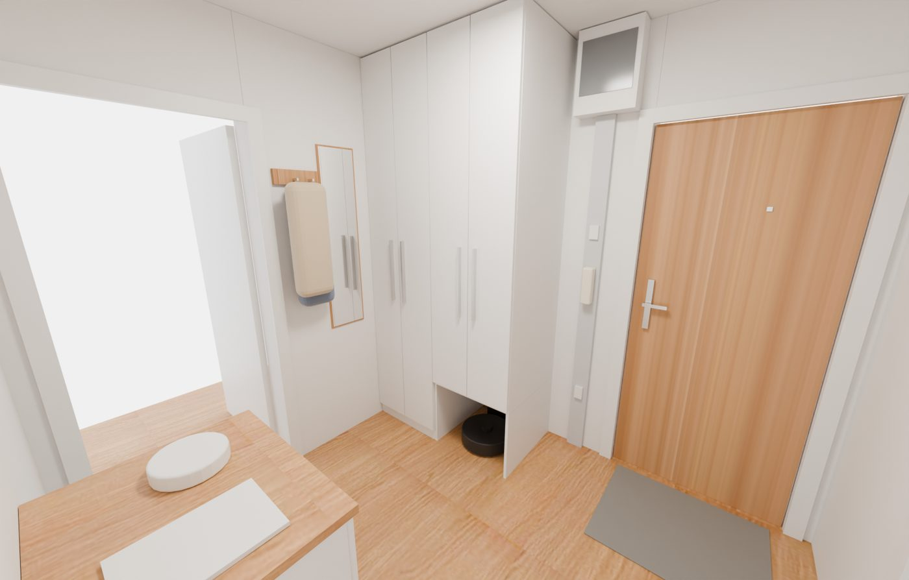

# Podklad pro montáž z IKEA – byt 2+kk (listopad 2026)

Dobrý den, posíláme seznam věcí, které bychom rádi pořídili **z IKEA** a nechali složit.
U každé věci je **náš rozměr** (z měření v bytě), **náš tip na IKEA řadu** a obrázek, jak si to představujeme.

**Prosíme o:** ověření, jestli to z IKEA jde (rozměry, dostupnost, plánovač PAX/BESTÅ/METOD), případně
lepší návrh, a orientační cenu (díly + montáž). Tipy na konkrétní řady jsou naše odhady – rádi se necháme poradit.

Všechny rozměry jsou v **mm**, světlé rozměry mezi stěnami. Rendery jsou orientační (barvy, proporce).

| # | Věc | Místnost | Náš tip IKEA | Priorita |
|---|---|---|---|---|
| 1 | Šatní skříň 1500 × 600 se zrcadlovými posuvnými dveřmi | ložnice | PAX 2 × 75 + posuvné dveře 150 + KOMPLEMENT | vysoká |
| 2 | Plovoucí TV skříňky 3000–3100 × 400 | obývák | BESTÅ závěsné 5 × 60 × 40 × 38 | vysoká |
| 3 | 2 vysoké skříně v předsíni, jedna s nikou pro robotický vysavač | předsíň | PAX 2 × 50 (úprava: nika bez dna) | zvažujeme |
| 4 | Police + děrovaná deska v komoře | komora | IVAR (nebo BOAXEL) + SKÅDIS | střední |
| 5 | Drobnosti: botník, věšák, zrcadlo | předsíň | TRONES, háčky, zrcadlo | nízká |
| – | *Ložnice (postel, stůl, knihovny)* | ložnice | *zatím nerozhodnuto – doplníme později* | – |

**Co NEDĚLÁ montér IKEA:** kuchyňská linka, dubové hranoly a dlouhá police na TV stěně (truhlář);
jídelní stůl, židle, pohovka a skříňka na tříděný odpad (zajistíme sami).
U TV stěny se práce potkají – viz bod 2.

---

## 1) Šatní skříň – ložnice

| | |
|---|---|
| místo | roh ložnice u dvou stěn, šířka **max. 1500** (vedle jsou dveře do pokoje – otevřené křídlo končí ~1640 od stěny) |
| strop | **2597** (změřeno) → korpus 236 lze postavit (úhlopříčka ~2434); nad korpusem ~23 cm → krycí panel/lišta ke stropu |
| hloubka | korpus 580 + posuvné dveře → celkem ~660 je OK |
| dveře | **2 posuvná zrcadlová křídla**, každé kryje jednu sekci |
| levá sekce (75) | **výsuvný věšák na kalhoty** (~240–800), nad ním **tyč ve výšce 1600** (krátké věšení – košile), police 1700, nahoře police ~2130 (kufr) |
| pravá sekce (75) | **3 zásuvky** (do ~800), police nad nimi, **tyč ve výšce 1600**, police 1700 a 1920, nahoře ~2130 (deky) |
| proč tyče na 1600 | aby dosáhla i menší postava; dlouhé věšení ve skříni nechceme |
| tip IKEA | PAX 2 × 75 × 58 × 236 (bílý), posuvné zrcadlové dveře 150 × 236, KOMPLEMENT: výsuvný věšák na kalhoty 75, 3 zásuvky 75, 2 tyče 75, police |
| pozor | kotvení ke zdi |

---

## 2) Plovoucí TV skříňky – obývák (levá stěna)

| | |
|---|---|
| délka | **3100** (stačí 3000), hloubka **400**, výška **~350–380** |
| výška nad podlahou | spodní hrana **250**, horní **600** (pod skříňkami se vytírá, LED pásek pod nimi) |
| úseky (od oken) | zásuvka · **otevřená nika** (router, konzole) · zásuvka · **výklop** · **otevřená přihrádka se 2 koši** |
| tip IKEA | **BESTÅ závěsné 5 × 60 × 40 × 38** (= 3000) na nástěnné liště, bílá čela, 2 × zásuvka, 1 × bez dvířek, 1 × výklop/dvířka, 1 × bez dvířek + 2 koše; LED pásek pod skříňky |
| zeď | ověřit materiál levé stěny (beton / cihla / SDK) kvůli závěsu |
| koordinace s truhlářem | **nad skříňkami (od 600 do stropu) přijdou dubové hranoly 40 × 40 a dlouhá police s LED** – dělá truhlář. Prosíme nejdřív pověsit BESTÅ, pak hranoly. Domluvit, kdo dělá LED a kde bude zdroj. |

---

## 3) Předsíň – 2 vysoké skříně z PAX (zvažujeme)

Zatím se rozhodujeme mezi truhlářem a PAX – prosíme o názor, jestli to takhle půjde.

| | |
|---|---|
| místo | stěna proti vstupním dveřím, od rohu; volná šířka **1117** (dál je rozvaděč s pojistkami, musí zůstat přístupný) |
| strop | **2443** → korpus 236,4 při zvedání z lehu potřebuje ~2434 → **vůle jen ~9 mm**; prosíme skládat nastojato, nebo použít korpus 201 |
| sestava | **2 × PAX 50 × 58 × 236** (= 1000, k rozvaděči zůstane 167), nahoře krycí lišta ke stropu (~79 mm) |
| levý korpus | dvířka 50 × 229; dole výsuvná police na vysoké boty, **tyč ve výšce 1600**, police 1700, nahoře ~2130 |
| pravý korpus – **nika pro robotický vysavač** | **0–450 otevřeno, bez dna a bez soklu** (robot vjíždí po podlaze předsíně). Korpus složit bez dna a soklu, **dno připevnit napevno ve výšce 450** (navrtat), **záda zkrátit** a přibít od 450 nahoru, případně latka vzadu dole. Dvířka **50 × 195** jen od niky nahoru. Police 830, 1210, 1700, ~2130 |
| kotvení | oba korpusy do zdi (u korpusu s nikou nutně); podlaha je vinyl – vyrovnat podložkami pod boky |
| robot | zásuvka je hned vpravo vedle skříně na liště (~400 nad podlahou) → kabel bokem do niky |
| záruka | úpravu korpusu bereme na sebe, ztráta záruky nevadí |

---

## 4) Komora (mimo byt, přes chodbu) – police a nářadí

| | |
|---|---|
| rozměr | **1352** (stěna se dveřmi) × **892** (hloubka), strop **2598**; dveře 613 se otevírají **ven** |
| zadní stěna (1352) | **police hloubky 300 po celé šířce, od výšky 1000 až nahoru** (1000 konzervy · 1300 zásoby · 1600 čisticí prostředky · 1900 nářadí v krabicích · ~2250 sezónní krabice). **Pod policemi volná podlaha** (vysavač, kbelík, schůdky) |
| levá stěna | **děrovaná deska** ~56 × 112 (2 desky nad sebou) na ruční nářadí, pod ní na zemi kufry |
| u dveří vlevo | lišta s háčky na mop, koště, lopatku |
| pravá stěna | držák tyčového vysavače (od výrobce vysavače) u lišty s vypínačem; zásuvku dodělá elektrikář |
| tip IKEA | **IVAR** sekce 89 + 42, hloubka 30 (vejde se do 1352 – ověřit), nebo **BOAXEL** na zeď (60 + 60); **SKÅDIS** 2 × 56 × 56 + háčky |

---

## 5) Předsíň – drobnosti
- **botník** mělký na zeď (např. TRONES) + malá stolička na sezení (lavice max. ~55 cm široká),
- **věšák** (lišta s háčky) a **zrcadlo** na stěnu.

---

*Podklad připravený z návrhu bytu (výkresy a vizualizace vlastní). Rozměry IKEA dílů jsou naše odhady –
prosíme ověřit v aktuální nabídce.*
